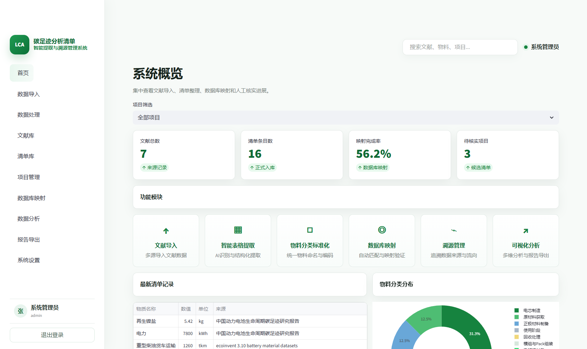
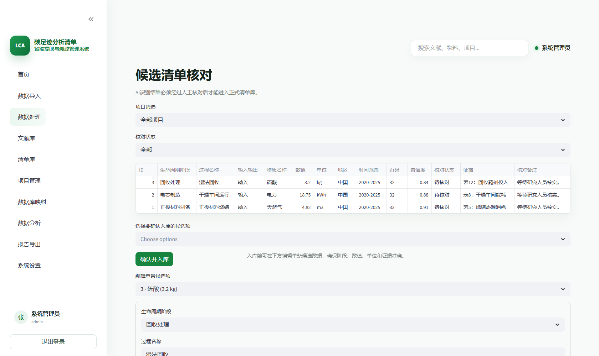
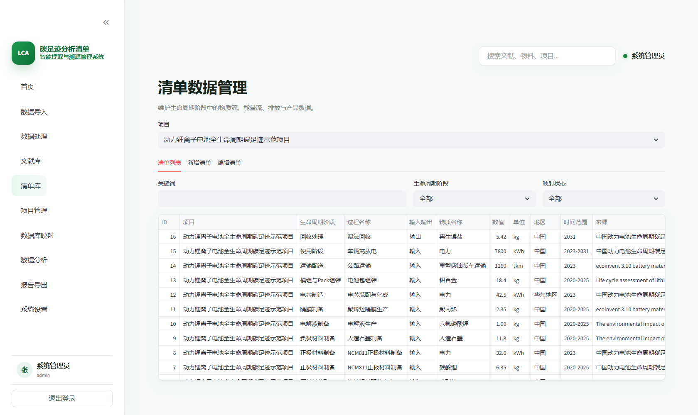
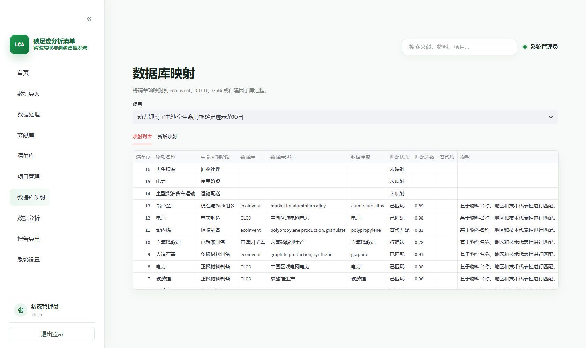

# 全生命周期碳足迹分析清单智能提取与溯源管理系统

**LCA 碳足迹清单管理系统 · V1.0.0 · 已获计算机软件著作权登记证书**

面向锂电池生命周期评价（LCA）与碳足迹研究，将分散的文献、清单数据与来源证据组织到同一个研究工作台，减少重复整理，支持后续建模与核对。

本页为软件成果与界面展示，无需安装或登录即可浏览。这里不提供在线运行入口，也不公开系统源码。

## 系统概览

## 软件著作权信息

| 项目 | 内容 |
| --- | --- |
| 软件名称 | 全生命周期碳足迹分析清单智能提取与溯源管理系统 |
| 软件简称 | LCA碳足迹清单管理系统 |
| 版本 | V1.0.0 |
| 著作权人 | 北京理工大学 |
| 登记号 | 2026SR0868777 |
| 证书号 | 软著登字第18083058号 |

## 解决什么问题

LCA研究需要反复从论文、报告和表格中整理物质投入、能源消耗、排放等清单数据。数据单位、研究边界、时间范围和地区信息往往不一致，后续核对时还需要重新查找原始出处。

本系统围绕“文献导入 → 候选数据提取 → 人工核对 → 清单入库 → 来源追溯 → 数据库映射 → 报告导出”组织工作流程，把数值与文献、页码、原文证据关联起来，为研究数据的透明度和可重现性提供支持。

## 主要功能

| 模块 | 功能 |
| --- | --- |
| 项目管理 | 记录产品对象、功能单位、系统边界和研究阶段 |
| 文献导入 | 解析PDF与Word（DOCX）；扫描PDF识别依赖可选OCR环境 |
| AI辅助提取 | 用户自行配置兼容接口，提取候选物质、数值、单位及证据；不内置API Key |
| 人工核对 | 编辑候选条目，确认后写入正式清单库 |
| 清单管理 | 按生命周期阶段管理物质流、能源流及相关属性 |
| 来源追溯 | 记录文献标题、作者、年份、DOI/URL、页码和原文摘录 |
| 数据库映射 | 记录与ecoinvent、CLCD、GaBi或自建因子库的对应关系及匹配状态 |
| 看板与报告 | 展示阶段分布与整理进度，支持Excel及Markdown报告导出 |

数据库映射功能用于管理对应关系，不包含商业数据库授权或其完整数据。AI提取结果需要人工核实，不直接作为研究结论。

## 界面展示

**以下均为说明书制作时的功能演示截图。截图中的数值、来源关联、置信度和映射状态为示例配置，不代表经验证的文献提取结果或实际研究结论。**

### 候选清单核对

查看阶段、物质、数值、单位、页码和证据，编辑核对结果后选择入库。

### 清单数据管理

按项目、生命周期阶段和映射状态筛选条目，统一管理清单字段。

### 数据库映射

记录清单与目标过程的匹配、替代项和说明，便于后续建模检查。

## 技术实现

Python · Streamlit · SQLite · SQLAlchemy · pandas / openpyxl · PDF / Word解析 · OpenAI兼容接口

系统采用本地Web应用形式，AI能力通过用户配置的第三方接口提供。本公开仓库仅收录软件介绍与展示图片，不包含应用源代码、本地数据库、上传文献、账号凭据或API密钥。

## 权利说明

软件著作权人为北京理工大学。本页公开展示不构成软件源码开放或开源许可，亦不授予软件复制、修改或商业使用权。
